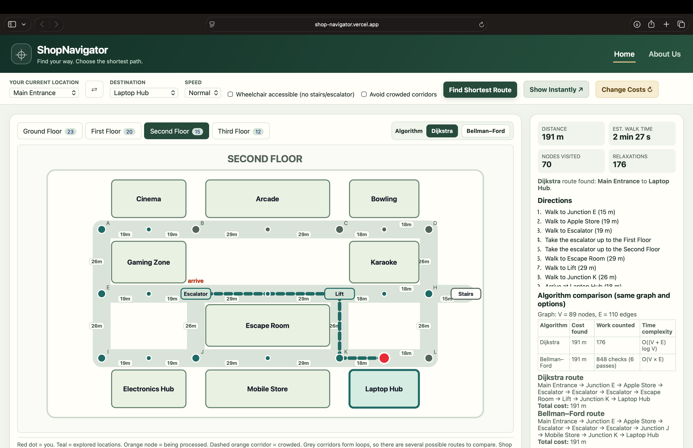

# ShopNavigator 🛍️

ShopNavigator is an interactive mall navigation system that helps users find the shortest route between locations across four floors of a shopping mall.

## 🚀 Live Demo

[**Explore ShopNavigator →**](https://shop-navigator.vercel.app)

## 🖥️ Simulation Preview

## ✨ Features

- **Multi-Floor Navigation:** Explore a simulated mall with four floors and multiple stores.
- **Shortest-Path Algorithms:** Find routes using Dijkstra's Algorithm and Bellman–Ford Algorithm.
- **Animated Route Visualization:** Watch the algorithm explore locations and highlight the selected route.
- **Algorithm Comparison:** Compare route costs, computational work, and time complexity.
- **Accessibility Option:** Find routes that avoid stairs and escalators.
- **Crowd Avoidance:** Apply higher costs to crowded corridors to explore alternative routes.
- **Interactive Controls:** Change starting points, destinations, simulation speed, and corridor costs.

## 🧠 Algorithms Used

- **Dijkstra's Algorithm:** Uses a priority queue to find shortest paths with non-negative edge weights.
- **Bellman–Ford Algorithm:** Repeatedly relaxes graph edges to calculate shortest paths.

## 🛠️ Technologies Used

- HTML5
- CSS3
- JavaScript
- SVG for interactive graph and route visualization

## 🎯 Project Objective

To demonstrate graph representation and shortest-path algorithms through a visual, interactive simulation of navigation inside a multi-floor shopping mall.

## 🚀 Getting Started

1. Clone or download this repository.
2. Open `index.html` in a web browser.
3. Select your starting location and destination.
4. Choose an algorithm and navigation preferences.
5. Click **Find Shortest Route** to view the route and algorithm execution.

## 📚 Academic Context

This project demonstrates concepts from Design and Analysis of Algorithms (DAA), including graph traversal, shortest-path computation, algorithm comparison, and time complexity analysis.
